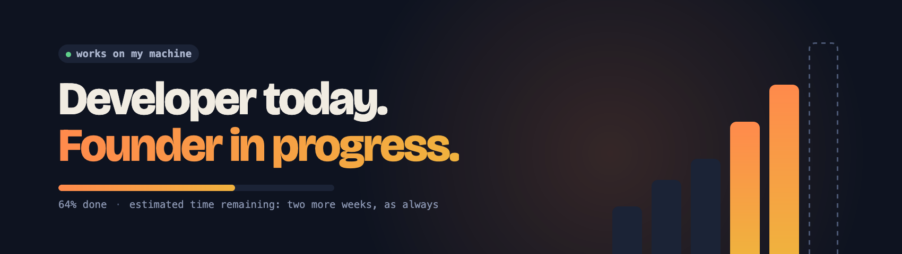
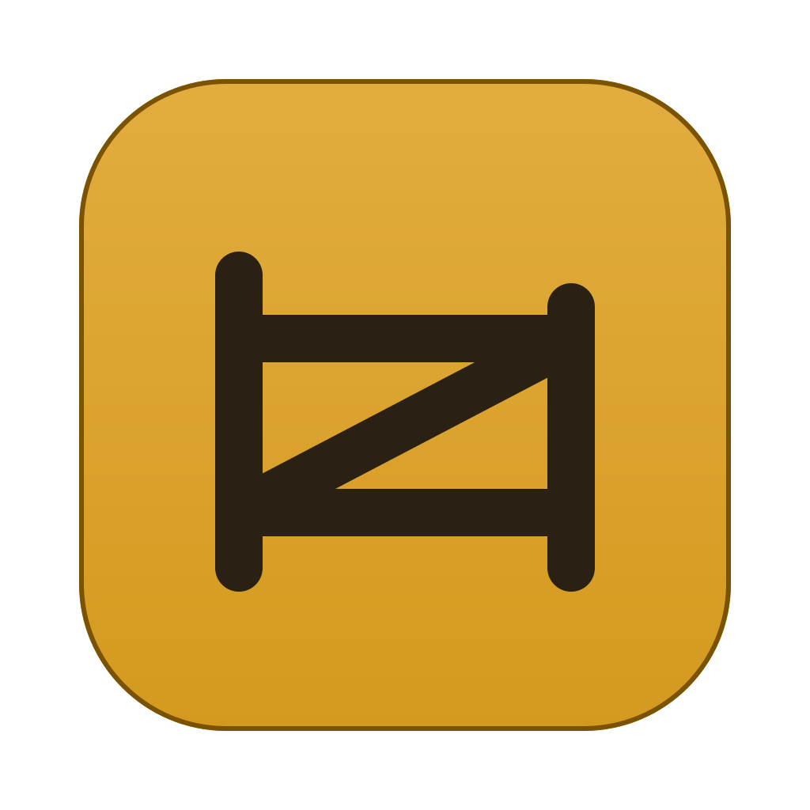

<p align="center">
  
</p>

### Hi, I'm John 👋

I'm a software developer who works in **PHP**, **Laravel** and **Swift**. I build the tools I wish existed, then share them.

- 🔨 Building something new, launching soon. More when it's real.
- 🐎 Made [**Paddock**](https://gowelle.github.io/paddock/), a local PHP environment for Intel Macs, because mine refused to retire.
- 📦 Maintain six Laravel packages that turn awkward APIs into clean code.
- 🧪 Firm believer that software should work the moment you install it. Mine does, on my machine.
- 🗂️ [**The catalogue**](https://goel-6yiatanstr2.qoder.website/) — every project here, with the story behind each one.

<p>
  
  
  
  
  
  
</p>

---

###  Paddock

**A local PHP and Laravel environment for Intel Macs that works the moment it is installed.** A native menu bar app, a background service and a CLI: every project folder is served at its own `.test` address, with PHP, databases, mail, logs, dumps and Xdebug built in. Free.

<p>
  <a href="https://gowelle.github.io/paddock/"></a>
  <a href="https://github.com/gowelle/paddock/releases/latest"></a>
  <a href="https://github.com/gowelle/paddock/actions/workflows/tests.yml"></a>
  <a href="https://github.com/gowelle/paddock/releases"></a>
</p>

```sh
curl -fsSL https://raw.githubusercontent.com/gowelle/paddock/main/Scripts/install.sh | bash
```

---

### 📦 Laravel packages

| Package | What it does | Version | Installs |
|---|---|---|---|
| [**flutterwave-php**](https://github.com/gowelle/flutterwave-php) | Flutterwave v4 payments, the Laravel way | [](https://packagist.org/packages/gowelle/flutterwave-php) | [](https://packagist.org/packages/gowelle/flutterwave-php) |
| [**laravel-beem-africa**](https://github.com/gowelle/laravel-beem-africa) | Beem's SMS, OTP, airtime and payments in one interface | [](https://packagist.org/packages/gowelle/laravel-beem-africa) | [](https://packagist.org/packages/gowelle/laravel-beem-africa) |
| [**laravel-route-matrix**](https://github.com/gowelle/laravel-route-matrix) | Google Routes API: distances and routes without the boilerplate | [](https://packagist.org/packages/gowelle/laravel-route-matrix) | [](https://packagist.org/packages/gowelle/laravel-route-matrix) |
| [**sku-generator**](https://github.com/gowelle/sku-generator) | Meaningful, unique SKUs for products and variants | [](https://packagist.org/packages/gowelle/sku-generator) | [](https://packagist.org/packages/gowelle/sku-generator) |
| [**azure-moderator**](https://github.com/gowelle/azure-moderator) | Content moderation with Azure AI Content Safety | [](https://packagist.org/packages/gowelle/azure-moderator) | [](https://packagist.org/packages/gowelle/azure-moderator) |
| [**google-moderator**](https://github.com/gowelle/google-moderator) | Text and image moderation with Google AI | [](https://packagist.org/packages/gowelle/google-moderator) | [](https://packagist.org/packages/gowelle/google-moderator) |

Each one installs with `composer require gowelle/<name>`.

---

### ✍️ Writing

- [My Intel Mac was left behind, so I built its local PHP environment myself](https://medium.com/@chiefmfalme/my-intel-mac-was-left-behind-so-i-built-its-local-php-environment-myself-b7d1d0c562ab)
- [Vue.js support for legacy browsers in Laravel](https://medium.com/@chiefmfalme/vuejs-support-for-legacy-browsers-laravel-bfce528baa33)

More on [Medium](https://medium.com/@chiefmfalme) and at [gowelle.github.io](https://gowelle.github.io/). I'm [@msadiniPekee](https://x.com/msadiniPekee) on X.

---

<p align="center">
  <sub>Found a bug in something of mine? Open an issue on that repository. I read everything, usually before coffee.</sub>
</p>
